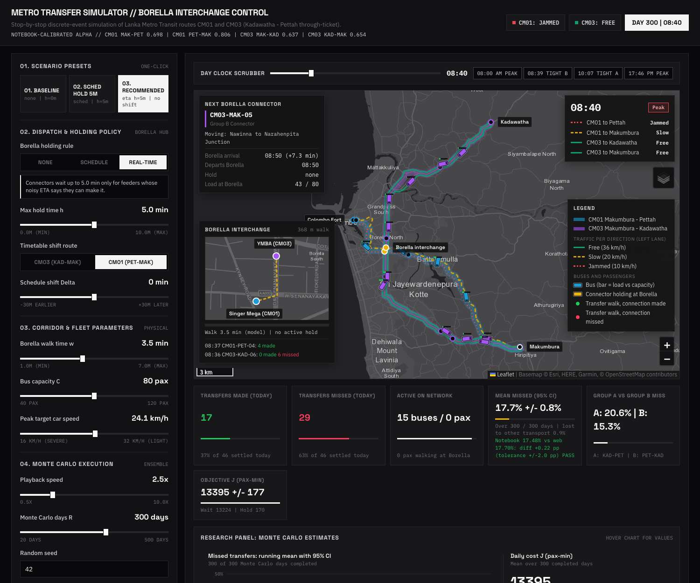
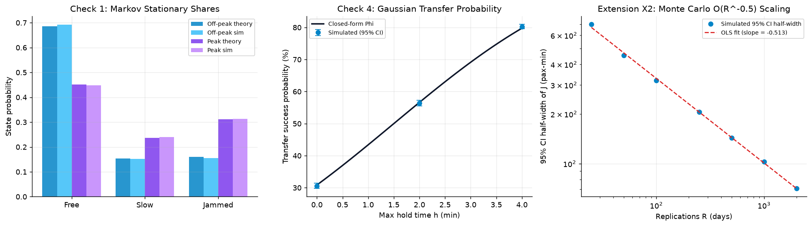

# Metro Transfer Simulator

Discrete-event simulation of Lanka Metro Transit bus transfers at Borella, Colombo (routes CM01 and CM03), evaluating holding rules and timetable coordination for a two-way Kadawatha-Pettah through-ticket.

**[Live Demo (GitHub Pages)](https://nayanthanethsara.github.io/metro-transfer-simulator/)**

[](https://colab.research.google.com/github/nayanthanethsara/metro-transfer-simulator/blob/main/notebook/metro-transfer-simulator.ipynb)



## The problem

Lanka Metro Transit operates fixed-schedule, digitally ticketed Metro buses along Route CM01 (Makumbura to Pettah, via Colombo Fort) and Route CM03 (Makumbura to Kadawatha), every 15-35 minutes (116 trips a day on 12 + 11 buses). Both call at Borella, at two stops about 370 m apart, but there is no direct Kadawatha-Pettah route. A through-ticket with one transfer at Borella would connect both directions simultaneously:

- **Group A (Kadawatha to Pettah):** CM03 from Kadawatha to Borella (`Borella 02 - YMBA`), transferring to CM01 towards Pettah (`Singer Mega-Colombo 8`).
- **Group B (Pettah to Kadawatha):** CM01 from Pettah to Borella, transferring to CM03 towards Kadawatha.

The ticket is part-paid: the passenger pays part of the fare on the first bus and the balance on the connecting bus within a validity window (proposed: 2 hours). Seats are not reserved, so boarding at Borella is first come, first served, and a passenger who cannot board either waits for the next Metro bus or leaves to use other transport.

Uncoordinated timetables, road traffic variability, dwell-time fluctuations and an 80-passenger capacity make transfers fragile: the median scheduled connection has under 10 minutes of slack, and a missed connection adds up to half an hour of waiting. **Question:** What holding rule (none, schedule-based or real-time ETA-based) and timetable adjustment at Borella keep missed connections low in both directions, without delaying passengers already on board too much, using only the current Metro fleet?

## Quick start

**Interactive web demo:** Open the [live demo](https://nayanthanethsara.github.io/metro-transfer-simulator/), or clone/download this repository and double-click `docs/index.html` in any modern browser (Chrome, Edge, or Firefox).

**Google Colab notebook:** Click the Open in Colab badge above and select `Runtime -> Run all`.

**Run locally (optional):**

```bash
pip install -r requirements.txt
jupyter notebook notebook/metro-transfer-simulator.ipynb
```

**Optional empirical traffic extraction (`cmb_traffic`):**

```bash
git clone https://github.com/nuuuwan/cmb_traffic.git /tmp/cmb_traffic
python scripts/extract_cmb_traffic.py --cmb-repo /tmp/cmb_traffic --output data/traffic/corridor_speeds.csv
```

## Using the demo

Full controls, output definitions, and scenario walkthroughs: [USER_GUIDE.md](USER_GUIDE.md).

## Model and mathematics

Full derivations, Markov chain formulation, discrete-event queueing rules, assumptions, and parameter provenance: [THEORY.md](THEORY.md).

Summary of the three-layer model:
1. **Road traffic layer:** Three-state discrete-time Markov chain (`Free: 36 km/h`, `Slow: 20 km/h`, `Jammed: 10 km/h`) on $5\text{ min}$ slots with separate peak (`06:00-09:00`, `17:00-20:00`) and off-peak transition matrices calibrated via bisection to `cmb_traffic` corridor speeds (`29.37 / 24.10 km/h`).
2. **Bus journey layer:** Stop-by-stop bus progression over OpenStreetMap road distances, with Poisson passenger arrivals at a time-varying rate sampled by inverse transform and thinning, uniform downstream destinations, linear dwell times $t_{\text{dwell}} = (12 + 2 a_s + 3 b_s)/60\text{ min}$, and FIFO boarding capped at $C = 80$. Departure times come from the LMT-GO app; Borella and terminal times follow from scheduled run times (CM01 75 min, CM03 120 min), with Borella placed in proportion to road distance.
3. **Borella transfer layer:** Priority-queue discrete-event simulation pairing feeders and opposite-direction connectors under `none`, `schedule`, and `realtime` (ETA-based) holding policies, with first-come-first-served boarding shared with local Borella passengers, a passenger patience limit ($P = 60\text{ min}$) and ticket validity ($V = 120\text{ min}$) after which passengers leave for other transport. Policies minimize daily equivalent passenger-minutes $J(h, \Delta) = w_{\text{wait}} \mathbb{E}[\sum_i (w + W_i) + \pi_{\text{alt}} N_{\text{oow}}] + w_{\text{hold}} \mathbb{E}[\sum_b N_b \cdot \text{hold}_b]$.

## Verification

All fifteen verification checks (Markov stationary shares, calibrated corridor speeds and leg runtimes, zero-variance limit, closed-form Gaussian transfer probability, exact passenger conservation, $h=0$ policy equivalence, capacity invariants, common-random-numbers variance reduction, thinning arrival intensity, journey speed against the harmonic mean, the exact-ETA limit of real-time holding, real bus duties consistent with the run times, the extra-bus duty, isolation of random draws when trips are added, and fixed through demand) plus $O(R^{-1/2})$ Monte Carlo error scaling are implemented with explicit `assert` statements in `notebook/metro-transfer-simulator.ipynb`.



## Concepts applied

This project applies next-event time-advance discrete-event simulation with FIFO passenger queueing, inverse-transform, thinning and Knuth/Box-Muller random variate generation, discrete-time Markov chains with stationary distribution calibration, and Monte Carlo integration with common random numbers and $O(R^{-1/2})$ confidence interval scaling based on the law of large numbers.

## Results, limitations and future work

- **Summary of findings (LMT-GO timetable of 19 Nov 2026; traffic calibrated to `cmb_traffic`; OpenStreetMap road distances; R = 1,000 common-random-number days, 95% CI):**
  - **Baseline (current timetable, no holding):** `25.57 +/- 0.48%` of through passengers miss their planned connection (about 72 of 290 a day), almost all through timing (`25.0%`) rather than full buses (`0.6%`). Because buses run every 15-35 min, only `1.96%` give up and use other transport and about 95% still finish the trip by Metro. The median scheduled slack is under 10 min, and four Pettah-Kadawatha connections are scheduled 0.2 min short of the walk.
  - **Recommended policy: real-time holding of up to 5 min, current timetable:** `17.48 +/- 0.44%` missed (about 49 a day), `0.92%` lost, mean Borella wait 17.9 min (from 20.7) and `J = 13426 +/- 101` pax-min (from `14807 +/- 103`, -9%). About 5 buses a day wait, for about 2 min each. Real-time holding costs riders on board about a sixth of the hold time of schedule holding for the same misses.
  - **Timetable shifts do not help:** no whole-route shift within +/- 10 min reduces misses on its own (best, CM01 -5 min: `25.80%`), because a shift that helps one direction hurts the other and a fixed timetable cannot absorb daily traffic delay. Combined with holding, the best shift gives the same `J` as holding alone (13,419 vs 13,426) and more misses, so the simpler policy is recommended.
  - **Longer holds:** misses keep falling with longer holds (about 12% at 10 min), but the model does not charge knock-on delay to later trips or to traffic behind a held bus, so holds are capped at 5 min.
  - **Fleet:** the 12 CM01 and 11 CM03 buses in the app run every trip; the recommended policy needs no extra buses. One extra bus placed to even out headways does not reduce misses (`25.4-27.5%`). Two late Kadawatha feeders have no CM01 connection; one later CM01 trip would serve them (not tested). The recommended timetable is in [data/recommended_timetable.csv](data/recommended_timetable.csv).
  - **Ticket validity:** `99.98%` of through passengers who board do so within 2 hours and 95% within about 55 min, so a one-hour part-paid ticket would cover almost everyone.
  - **Borella timing point:** if connectors never left Borella before their published time, misses would halve again (`8.9%`), but riders already on board would wait about 5,800 pax-min more a day, so `J` rises. Metro buses do not do this today.
- **Main limitations:** passenger demand and the Borella walk (3.5 min; the 370 m walk along Baseline Road suggests 4.5-5 min) are assumptions, and the walk time is the input the results are most sensitive to (16.4-22.2% missed for 2.0-6.5 min). The app gives departure times only, so run times come from metrobus.lk and Borella times are placed by road distance. Holding a bus at a roadside halt can block traffic, which is not modelled. Each direction has one traffic state that evolves independently, and a late or held bus does not delay its next trip in the simulation.

## Key references

Full IEEE reference list: [REFERENCES.md](REFERENCES.md).

- A. M. Law, *Simulation Modeling and Analysis*, 5th ed., 2015.
- T. Amalan, "Analysis of Bus Passenger Demand and Supply: Case Study on Western Province, Sri Lanka," *IJSRM*, 2021, doi: `10.18535/ijsrm/v9i11.em03`.
- R. W. Hall, M. Dessouky, and Q. Lu, "Optimal holding times at transfer stations," *Comput. Ind. Eng.*, 2001, doi: `10.1016/S0360-8352(01)00039-0`.
- N. I. Senaratna, Colombo Traffic Index (`cmb_traffic`), `https://github.com/nuuuwan/cmb_traffic`.

## AI assistance

Developed with the assistance of AI coding and writing tools. All equations, simulator logic, verification assertions, and documentation were reviewed and structured for reproducibility.

## Licence and credits

- Code: [MIT License](LICENSE).
- Schedules: LMT-GO mobile application (Lanka Metro Transit, accessed 19 Nov 2026); run times from `https://metrobus.lk` (accessed 19 Nov 2026).
- Road geometry and stop positions: OpenStreetMap contributors (ODbL), routed with OSRM.
- Open traffic schema: `github.com/nuuuwan/cmb_traffic` (MIT License).
