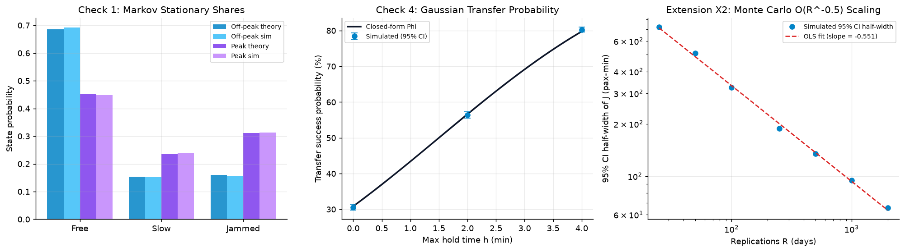

# Theory and mathematics

## 1. Problem formulation

## 2. Assumptions

## 3. Model equations

| Symbol | Meaning | Units | Value / range | Source |
|---|---|---|---|---|
| | | | | |

## 4. Numerical method

## 5. Verification

| Check | Expected | Obtained | Pass? |
|---|---|---|---|
| | | | |

## 6. Concepts applied

| Concept | Where it is used in this project |
|---|---|
| | |

## 7. References

See [REFERENCES.md](REFERENCES.md).
