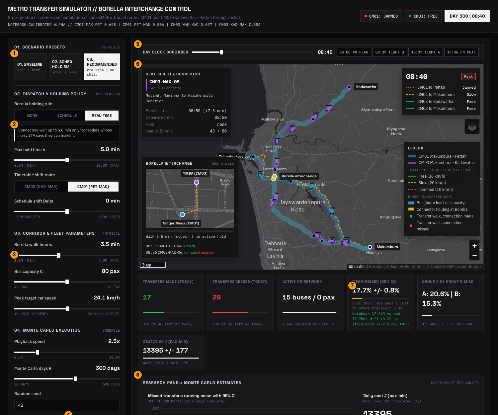

# User guide: Metro Transfer Simulator web demo

**Open the demo:** [https://nayanthanethsara.github.io/metro-transfer-simulator/](https://nayanthanethsara.github.io/metro-transfer-simulator/), or double-click `docs/index.html` in a modern browser (Chrome, Edge, or Firefox). Everything runs client-side with zero external servers or uploads.

The labels in the screenshot: (1) scenario presets, (2) holding rule and its plain-language description, (3) corridor and fleet parameters, (4) Start / Run All R / +1 Day / Reset, (5) day clock scrubber and quick jumps, (6) street map with the Trip Inspector, traffic panel and Borella Interchange inset, (7) running mean missed rate with the notebook check, (8) research panel with the convergence chart and cost breakdown.

## Controls

| Control | What it does | Range | Default |
|---|---|---|---|
| 01. Scenario Presets | Loads `01. BASELINE` (`none`, `h=0`), `02. HOLD 3M` (`schedule`, `h=3`), or `03. RT + SHIFT` (`realtime`, `h=10`, CM01 `+10 min`) | 3 presets | `02. HOLD 3M` |
| Borella holding rule | Segmented toggle for `NONE`, `SCHEDULE` (wait up to `h` past the connector's natural departure for every linked feeder), or `REAL-TIME` (wait only for feeders whose noisy ETA says they can make it) | 3 modes | `SCHEDULE` |
| Max hold time `h` | Maximum Borella hold past the connector's natural departure (arrival + dwell) | `0.0` to `10.0 min` (step `0.5`) | `3.0 min` |
| Timetable shift route | Segmented toggle choosing `CM03 (KAD-MAK)` or `CM01 (FOR-MAK)` | 2 routes | `CM03` |
| Schedule shift `Delta` | Uniformly shifts all departures of the selected route (both directions) | `-30` to `+30 min` (step `5`) | `0 min` |
| Borella walk time `w` | Walking time between `Borella 02 (YMBA)` and `Borella (Singer Mega)` | `1.0` to `7.0 min` (step `0.5`) | `3.5 min` |
| Bus capacity `C` | Maximum passenger load per bus before local/transfer boarding spills to the next trip | `40` to `120 pax` (step `10`) | `80 pax` |
| Peak target car speed | Target car speed used to calibrate the peak-hour traffic Markov matrix. Bus speed factors stay at their notebook values, so a lower value simulates a worse-than-usual traffic day | `16` to `32 km/h` (step `0.1`) | `24.1 km/h` (the `cmb_traffic` mean) |
| Playback speed | Animation speed multiplier for the daily transit map | `0.5x` to `10.0x` | `2.5x` |
| Monte Carlo days `R` | Total number of independent simulated days in the ensemble | `20` to `500 days` | `100 days` |
| Random seed | Integer seed for deterministic reproducible runs | `>= 1` | `42` |
| Day Clock Scrubber & Quick Jumps | Scrubs `04:30` to `22:30` or jumps directly to `08:00 AM PEAK`, `09:14 TIGHT B`, `14:39 TIGHT A`, or `17:46 PM PEAK` | `04:30` to `22:30` | `07:30` |
| Start / Pause | Starts or pauses the animated day-by-day Monte Carlo run | - | - |
| Run All R | Runs all remaining replications instantaneously to display converged 95% CIs | - | - |
| +1 Day | Advances immediately by one simulated day and updates running CIs | - | - |
| Reset | Re-initializes the RNG seed and resets Day 1 | - | - |

## Reading the outputs

- **Colombo Street Map:** A real street map (Leaflet with Esri basemap tiles, no API key) showing the CM01 (blue) and CM03 (purple) corridors along their actual roads. Stop locations come from OpenStreetMap and road paths from the OSRM router, generated by `scripts/build_corridor_geometry.py` into `docs/corridor-geo.js`. The simulator uses the same road distances, so bus positions on the map match the simulated travel. Each direction is drawn as its own left-hand lane coloured and patterned by its current traffic state (`Free` solid green, `Slow` dashed amber, `Jammed` dotted red). Bus markers point in their direction of travel, carry a load bar (green, amber above 70%, red when full), and pulse amber while a connector is holding at Borella. Use the layers button (top right) to switch between Dark, Light and Satellite basemaps.
- **Map overlays:** The top-left **Trip Inspector** shows the next Borella connector, or any bus you hover or click (click again or click the map to unpin). The top-right panel shows the clock, the peak/off-peak regime and the traffic state of all four directions. The bottom-left **Borella Interchange** inset zooms into the two Borella stops and the OpenStreetMap walking path between them, with walking transfer groups (green = connection made, red = missed, number = passengers), the holding countdown bar and the most recent transfer outcomes.
- **Research Panel:** The convergence chart plots the running Monte Carlo mean missed transfer rate (%) with its shaded 95% confidence band as days advance toward `R` (hover for exact values). The cost panel splits the daily objective `J` into `Transfer wait (2.0x)` and `On-board hold (1.0x)` passenger-minutes.
- **KPI Cards & Interactive Tables:** Six telemetry cards show today's made/missed counts with progress bars, network activity, running `Mean Missed (95% CI)` with the share lost to other transport, `Group A vs Group B Miss`, and `Objective J`. Under the mean missed rate, the **notebook check** compares this run with the notebook reference result for the same preset (see below). Clicking any row in the **Borella Connector Departures & Holds** table or any event in the **Borella Feeder Transfer Log** pauses the clock, jumps directly to that timestamp, and pins that bus in the Trip Inspector.

## Try this

1. Click **01. BASELINE**, set **Monte Carlo days R** to 300, click **Run All R**, and read the missed rate: about 15%, with Kadawatha-Pettah (Group A) missing about twice as often as Pettah-Kadawatha (Group B). The notebook check underneath should say PASS.
2. Click **02. HOLD 3M**, then **14:39 TIGHT A** in the quick-jump bar. `CM03-KAD-05` reaches Borella and its passengers walk to `CM01-MAK-09`; when the CM01 bus is running early or the CM03 bus is late, watch the connector hold (amber) in the Borella inset.
3. Click **03. RT + SHIFT** (CM03 timetable 10 min earlier, real-time holding up to 10 min) and **Run All R**. Group A misses fall sharply while Group B rises a little, and the total cost `J` is lowest of the three presets.
4. With preset 3 still selected, drag **Peak target car speed** down to 18 km/h and run again to see how a worse traffic day than the timetable assumes affects the policy.

## Check against the notebook

The browser engine (`docs/sim-engine.js`) is a direct port of the notebook model: the same cleaned timetables, OpenStreetMap road distances, Borella placement by road distance, thinning arrivals, dwell formula, Markov traffic calibration, first-come-first-served boarding at Borella, patience and ticket-validity rules, holding policies and objective. It uses the per-leg speed factors (`alpha`) calibrated in the notebook rather than recalibrating. The random number generators differ (`mulberry32` in the browser, NumPy PCG64 in the notebook), so individual days differ but ensemble means agree.

`docs/config.js` stores four notebook reference results (R = 1000 days): Baseline `15.05 +/- 0.56%`, Hold only schedule `h = 3` `12.48 +/- 0.52%`, Hold only real-time `h = 3` `12.75 +/- 0.53%`, and Joint real-time `h = 10`, CM01 `+10 min` `10.98 +/- 0.50%`. When the current settings match one of them (with default walk time, capacity and peak speed) and at least 300 days have run, the Mean Missed card shows the difference and whether it is within the stated tolerance of `+/- 2.0` percentage points. Running the browser engine for 1000 days on three seeds gave differences of `-0.3` to `+0.6` points for all four scenarios, in line with the spread between the notebook's own seed sets.

## Limitations

- Stop arrival rates, transfer demand and the Borella walk time are the same placeholders as in the notebook until field measurements are substituted in `docs/config.js`.
- Maximum replications in the interactive UI are capped at `500` days to keep the page responsive (versus `1000-2000` replications in the notebook).
- Changing the walk time, capacity or peak speed has no stored notebook reference, so the notebook check only applies to the presets with default physical parameters.
